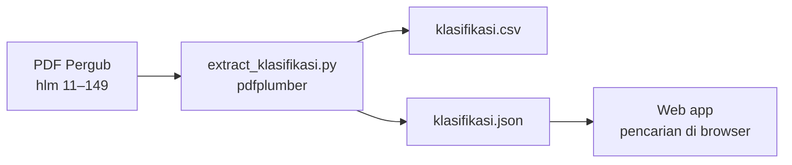

<p align="center">
  
</p>

<p align="center">
  <b>Cari kode klasifikasi arsip dalam hitungan detik.</b><br>
  Seluruh kode dan nama klasifikasi arsip Pemerintah Daerah dari Pergub Bali Nomor 64 Tahun 2023, dalam satu web yang ringan.
</p>

<p align="center">
  
  
  
  
  
  
</p>

<p align="center">
  <a href="#-fitur">Fitur</a> ·
  <a href="#-mulai-cepat">Mulai cepat</a> ·
  <a href="#-data">Data</a> ·
  <a href="#-struktur-proyek">Struktur</a> ·
  <a href="#-dokumen">Dokumen</a>
</p>

---

## ✨ Sekilas

Pergub Bali No. 64/2023 memuat daftar kode klasifikasi arsip di PDF setebal **893 halaman**. Mencari satu kode di dalamnya harus menggulir dan membaca manual. **Buku Saku Digital** menyajikan Lampiran I sebagai web yang bisa dicari: ketik kata atau awalan kode, lalu langsung dapat kode, nama, jalur induk, dan halaman sumbernya.

| | |
|---|---|
| 📚 **2.989** kode klasifikasi | 🗂️ **10** bidang · **56** sub-bidang |
| 📄 Setiap kode menyertakan **halaman PDF** sumbernya | 🔒 Tanpa server, tanpa login, tanpa pelacakan |

## 🧭 Fitur

| Fitur | Keterangan |
|---|---|
| 🔍 **Cari** | Ketik awalan kode (`000.1.2`) atau kata (`perjalanan dinas`). Kata hanya dicocokkan di awal kata, jadi `anggaran` tidak menarik `pelanggaran` |
| ✏️ **Toleran salah ketik** | `perjalnan dinas` otomatis diperbaiki, dan pengguna diberi tahu |
| 🌳 **Telusur** | Kolom bertingkat dari bidang sampai tingkat 4, dengan kartu detail kode terpilih |
| 📋 **Salin kode** | Satu klik, siap ditempel di nomor surat |
| 📖 **Buka PDF** | Langsung ke halaman sumber di Pergub |
| 🕘 **Terakhir dilihat** | Disimpan di perangkat sendiri, tanpa akun |
| 📱 **Responsif** | Sidebar di desktop; bilah atas dan menu bawah di HP |
| ⌨️ **Pintasan** | Tekan `/` atau `Ctrl+K` dari halaman mana pun untuk mencari |

## 🚀 Mulai cepat

> Jalankan perintah dari folder **`web`**, bukan dari folder utama.

```bash
cd web
npm install        # sekali saja
npm run dev        # buka http://localhost:5173
```

| Perintah | Fungsi |
|---|---|
| `npm run dev` | Server pengembangan dengan muat ulang otomatis |
| `npm test` | 17 uji untuk data dan pencarian |
| `npm run build` | Pemeriksaan tipe lalu build ke `web/dist` |
| `npm run preview` | Mencoba hasil build |

**Menayangkan:** unggah folder `web/dist` ke hosting statis mana pun (Netlify, Vercel, GitHub Pages). Aplikasi memakai alamat berawalan `#/`, jadi tidak perlu pengaturan khusus di server.

## 🔎 Cara kerja pencarian

| Yang diketik | Hasilnya |
|---|---|
| `000.5` | Kode 000.5 dan seluruh turunannya, dengan bagian kode yang cocok disorot (tidak menarik `000.50`) |
| `perjalanan dinas` | Semua kata harus muncul di awal kata pada nama atau uraian "antara lain" |
| `000.1 perjalanan` | Gabungan: turunan 000.1 yang namanya mengandung "perjalanan" |
| `perjalnan dinas` | Tidak ada hasil, jadi kata diperbaiki ke `perjalanan dinas` dan pengguna diberi tahu |

Hasil dibedakan menjadi **jenis arsip** (kode tanpa turunan) dan **kelompok** (kode yang punya turunan).

## 📊 Data

Sumber: **Peraturan Gubernur Bali Nomor 64 Tahun 2023**, Lampiran I (Klasifikasi Arsip Pemerintah Daerah), halaman 11–149 PDF.



**Cara data diperiksa**
- ✅ Tidak ada kode ganda, dan setiap kode (selain bidang) memiliki induk
- ✅ Jumlah per bidang dicocokkan otomatis lewat uji
- ✅ Kode dibandingkan dengan Lampiran II, yang memuat kode yang sama
- ⚠️ **10 baris dikoreksi atau ditambahkan** karena salah ketik nomor kode di PDF. Nomor aslinya tetap disimpan, dan daftarnya tampil di halaman *Tentang Data*
- ⚠️ 20 jenis arsip yang tidak terbaca di Lampiran II belum dicocokkan satu per satu

| Bidang | Kode | Bidang | Kode |
|---|---:|---|---:|
| 000 Umum | 235 | 500 Perekonomian | 1.306 |
| 100 Pemerintahan | 75 | 600 Pekerjaan Umum dan Ketenagaan | 285 |
| 200 Politik | 88 | 700 Pengawasan | 18 |
| 300 Keamanan dan Ketertiban | 41 | 800 Kepegawaian | 120 |
| 400 Kesejahteraan Rakyat | 736 | 900 Keuangan | 85 |

### Memperbarui data

Bila Pergub direvisi atau daftar koreksi berubah:

```bash
pip install pdfplumber
python scripts/extract_klasifikasi.py     # menulis data/ dan web/public/data/
cd web && npm test && npm run build
```

Koreksi nomor kode ada di `KOREKSI`, `KOREKSI_NAMA`, dan `TAMBAHAN` di dalam skrip. Rinciannya di [`docs/ERD.md`](docs/ERD.md#6-koreksi-data).

## 🗂️ Struktur proyek

```
Buku Saku/
├── web/                          Aplikasi
│   ├── src/
│   │   ├── pages/                Beranda, Cari, Telusur, Tentang
│   │   ├── components/           Layout, ikon & logo, toast, salin
│   │   ├── data.ts               Model data dan hierarki
│   │   ├── search.ts             Logika pencarian
│   │   └── search.test.ts        Uji data dan pencarian
│   └── public/
│       ├── data/klasifikasi.json Data yang dimuat aplikasi
│       └── pergub-64-2023.pdf    Untuk tautan "Buka PDF hlm N"
├── scripts/extract_klasifikasi.py
├── data/                         Hasil ekstraksi (CSV, JSON, laporan)
└── docs/                         PRD, ERD, DESIGN, mockup, logo
```

## 🛠️ Teknologi

| Lapisan | Pilihan |
|---|---|
| Antarmuka | React 19 + TypeScript (strict) |
| Build | Vite |
| Gaya | CSS biasa, tanpa framework |
| Pencarian | Buatan sendiri, berjalan di browser |
| Navigasi | React Router (hash) |
| Ekstraksi data | Python + pdfplumber |
| Font | Plus Jakarta Sans, JetBrains Mono |

## 📁 Dokumen

| Dokumen | Isi |
|---|---|
| [PRD](docs/PRD.md) | Tujuan, pengguna, fitur, dan kriteria penerimaan |
| [ERD](docs/ERD.md) | Model data, kamus data, dan daftar koreksi |
| [DESIGN](docs/DESIGN.md) | Arsitektur, peta halaman, istilah, dan design token |
| [Mockup](docs/ui/) | Rancangan tampilan desktop dan mobile |
| [Logo](docs/logo/) | Ikon, versi horizontal, dan lembar presentasi |

---

<p align="center">
  <sub>
    <b>Bukan aplikasi resmi pemerintah.</b> Buku saku ini hanya memudahkan pencarian.
    Dasar hukumnya tetap Peraturan Gubernur Bali Nomor 64 Tahun 2023; bila ada perbedaan, naskah resmi yang berlaku.
  </sub>
</p>
