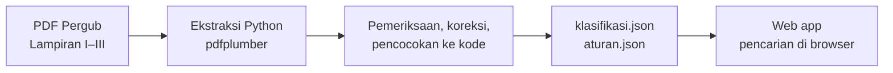

<p align="center">
  
</p>

<p align="center">
  <b>Cari kode klasifikasi arsip dalam hitungan detik.</b><br>
  Seluruh kode klasifikasi arsip Pemerintah Daerah dari Pergub Bali Nomor 64 Tahun 2023, lengkap dengan keamanan, akses, dan retensinya, dalam satu web yang ringan.
</p>

<p align="center">
  
  
  
  
  
  
  
</p>

<p align="center">
  <a href="#fitur">Fitur</a> ·
  <a href="#mulai-cepat">Mulai cepat</a> ·
  <a href="#data">Data</a> ·
  <a href="#struktur-proyek">Struktur</a>
</p>

---

## Sekilas

Pergub Bali No. 64/2023 memuat daftar kode klasifikasi arsip di PDF setebal **893 halaman**. Mencari satu kode di dalamnya harus menggulir dan membaca manual. **Buku Saku Digital** menyajikan Lampiran I (klasifikasi), II (keamanan dan akses), dan III (jadwal retensi) sebagai web yang bisa dicari: ketik kata atau awalan kode, lalu langsung dapat kode, nama, jalur induk, dan halaman sumbernya.

| | |
|---|---|
| **2.989** kode klasifikasi | **10** bidang · **56** sub-bidang |
| Setiap kode menyertakan **halaman PDF** sumbernya | Tanpa server, tanpa login, tanpa pelacakan |

## Fitur

| Fitur | Keterangan |
|---|---|
| **Cari** | Ketik awalan kode (`000.1.2`) atau kata (`perjalanan dinas`). Kata hanya dicocokkan di awal kata, jadi `anggaran` tidak menarik `pelanggaran` |
| **Toleran salah ketik** | `perjalnan dinas` otomatis diperbaiki, dan pengguna diberi tahu |
| **Telusur** | Kolom bertingkat dari bidang sampai tingkat 4, dengan kartu detail kode terpilih |
| **Keamanan dan akses** | Kartu detail memuat klasifikasi keamanan (Biasa, Terbatas, Rahasia, Sangat Rahasia), akses terbuka atau tertutup, hak akses, dan dasar pertimbangan dari Lampiran II |
| ⏳ **Retensi** | Masa simpan aktif dan inaktif, total tahun, dan nasib akhir (Permanen atau Musnah) dari Lampiran III. Pencarian bisa disaring menurut keamanan dan nasib akhir |
| **Salin kode** | Satu klik, siap ditempel di nomor surat |
| **Buka PDF** | Langsung ke halaman sumber di Pergub. Di semua perangkat, PDF dibuka di penampil dalam aplikasi dengan tombol **Kembali**, zoom (cubit, ketuk dua kali, atau tombol +/−), dan pindah halaman (geser atau tombol) |
| **Terakhir dilihat** | Disimpan di perangkat sendiri, tanpa akun |
| **Responsif** | Sidebar di desktop; bilah atas dan menu bawah di HP |
| **Bisa dipasang & offline (PWA)** | Pasang ke layar utama HP atau laptop. Cari dan telusur tetap jalan tanpa internet; hanya PDF yang perlu online |
| ⌨ **Pintasan** | Tekan `/` atau `Ctrl+K` dari halaman mana pun untuk mencari |

## Mulai cepat

> Jalankan perintah dari folder **`web`**, bukan dari folder utama.

```bash
cd web
npm install        # sekali saja
npm run dev        # buka http://localhost:5173
```

| Perintah | Fungsi |
|---|---|
| `npm run dev` | Server pengembangan dengan muat ulang otomatis |
| `npm test` | 17 uji untuk data dan pencarian |
| `npm run build` | Pemeriksaan tipe lalu build ke `web/dist` |
| `npm run preview` | Mencoba hasil build |

**Menayangkan:** unggah folder `web/dist` ke hosting statis mana pun (Netlify, Vercel, GitHub Pages). Aplikasi memakai alamat berawalan `#/`, jadi tidak perlu pengaturan khusus di server.

### Gambar pratinjau tautan

Saat tautan dikirim lewat WhatsApp, LinkedIn, atau X, yang tampil adalah gambar [`web/public/og-image.jpg`](web/public/og-image.jpg) (1200 × 630, 77 KB). Aplikasi pesan hanya bisa membaca gambar ini dari **alamat lengkap**, jadi alamat situs ditulis di `ALAMAT_SITUS` pada [`web/vite.config.ts`](web/vite.config.ts) (saat ini `https://buku-saku.rajistha.my.id`).

Bila pindah domain, ubah `ALAMAT_SITUS`, atau build dengan `SITE_URL=https://domain-baru npm run build`. Variabel otomatis dari hosting sengaja tidak dipakai, karena di Vercel isinya alamat `*.vercel.app`, bukan domain sendiri. Sumber gambarnya ada di [`docs/logo/src/og-image.html`](docs/logo/src/og-image.html).

Setelah tayang, periksa pratinjaunya di [opengraph.xyz](https://www.opengraph.xyz) atau [Facebook Sharing Debugger](https://developers.facebook.com/tools/debug/). WhatsApp menyimpan pratinjau lama cukup lama, jadi untuk mencobanya kirim tautan dengan tambahan `?v=2` di belakangnya.

## Cara kerja pencarian

| Yang diketik | Hasilnya |
|---|---|
| `000.5` | Kode 000.5 dan seluruh turunannya, dengan bagian kode yang cocok disorot (tidak menarik `000.50`) |
| `perjalanan dinas` | Semua kata harus muncul di awal kata pada nama atau uraian "antara lain" |
| `000.1 perjalanan` | Gabungan: turunan 000.1 yang namanya mengandung "perjalanan" |
| `perjalnan dinas` | Tidak ada hasil, jadi kata diperbaiki ke `perjalanan dinas` dan pengguna diberi tahu |

Hasil dibedakan menjadi **jenis arsip** (kode tanpa turunan) dan **kelompok** (kode yang punya turunan).

## Data

Sumber: **Peraturan Gubernur Bali Nomor 64 Tahun 2023**:

| Lampiran | Isi | Halaman PDF |
|---|---|---|
| I | Klasifikasi Arsip Pemerintah Daerah | 11–149 |
| II | Klasifikasi Keamanan dan Akses Arsip Dinamis | 150–639 |
| III | Jadwal Retensi Arsip | 640–893 |



**Cara data diperiksa**
- Tidak ada kode ganda, dan setiap kode (selain bidang) memiliki induk
- Jumlah per bidang dicocokkan otomatis lewat uji
- Kode dibandingkan dengan Lampiran II, yang memuat kode yang sama
- Perhatian: **10 baris dikoreksi atau ditambahkan** karena salah ketik nomor kode di PDF. Nomor aslinya tetap disimpan, dan daftarnya tampil di halaman *Tentang Data*
- Perhatian: 20 jenis arsip yang tidak terbaca di Lampiran II belum dicocokkan satu per satu
- **Keamanan dan akses** (Lampiran II): 2.421 dari 2.441 jenis arsip punya data. Sisanya memang tidak punya baris di Lampiran II karena penomorannya berbeda
- **Retensi** (Lampiran III): Lampiran III tidak memakai kode klasifikasi, jadi nomornya (I, A, 1, a, …) dihitung ulang menjadi kode lalu dicek dengan kemiripan nama. Bidang ditentukan dari nama karena angka Romawi di PDF tidak berurutan. Hasilnya diperiksa pada sampel halaman terhadap tampilan asli PDF
- Perhatian: Sekitar 70 jenis arsip punya nilai retensi yang bersyarat, bergabung, atau terpotong di PDF. Untuk itu aplikasi hanya menampilkan rujukan halaman, bukan angka
- Perhatian: **Data keamanan dan retensi belum ditinjau arsiparis.** Diambil otomatis dari PDF; cocokkan dengan halaman PDF yang ditautkan sebelum dipakai untuk keputusan penyusutan atau pembukaan arsip

| Bidang | Kode | Bidang | Kode |
|---|---:|---|---:|
| 000 Umum | 235 | 500 Perekonomian | 1.306 |
| 100 Pemerintahan | 75 | 600 Pekerjaan Umum dan Ketenagaan | 285 |
| 200 Politik | 88 | 700 Pengawasan | 18 |
| 300 Keamanan dan Ketertiban | 41 | 800 Kepegawaian | 120 |
| 400 Kesejahteraan Rakyat | 736 | 900 Keuangan | 85 |

Data siap pakai ada di [`web/public/data/klasifikasi.json`](web/public/data/klasifikasi.json) (237 KB): kode, nama, uraian, dan halaman PDF, dan baris yang dikoreksi menyimpan nomor aslinya. Keamanan dan retensi per kode ada di [`web/public/data/aturan.json`](web/public/data/aturan.json) (235 KB).

## Struktur proyek

```
Buku Saku/
├── web/                          Aplikasi
│   ├── src/
│   │   ├── pages/                Beranda, Cari, Telusur, Tentang
│   │   ├── components/           Layout, ikon & logo, toast, salin
│   │   ├── data.ts               Model data dan hierarki
│   │   ├── search.ts             Logika pencarian
│   │   └── search.test.ts        Uji data dan pencarian
│   └── public/
│       ├── data/klasifikasi.json Data yang dimuat aplikasi
│       ├── pergub-64-2023.pdf    Untuk tautan "Buka PDF hlm N"
│       └── og-image.jpg          Gambar pratinjau tautan
└── docs/logo/                    Logo, ikon, dan sumber gambar pratinjau
```

## Teknologi

| Lapisan | Pilihan |
|---|---|
| Antarmuka | React 19 + TypeScript (strict) |
| Build | Vite |
| Gaya | CSS biasa, tanpa framework |
| Pencarian | Buatan sendiri, berjalan di browser |
| Navigasi | React Router (hash) |
| Offline | vite-plugin-pwa (Workbox) |
| Ekstraksi data | Python + pdfplumber |
| Font | Plus Jakarta Sans, JetBrains Mono |

---

<p align="center">
  <sub>
    <b>Bukan aplikasi resmi pemerintah.</b> Buku saku ini hanya memudahkan pencarian.
    Dasar hukumnya tetap Peraturan Gubernur Bali Nomor 64 Tahun 2023; bila ada perbedaan, naskah resmi yang berlaku.
  </sub>
</p>
