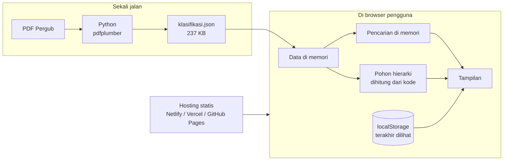
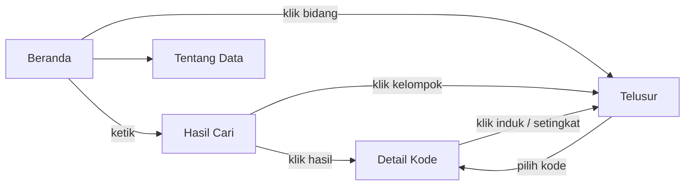

# DESIGN — Buku Saku Digital Pemprov Bali

Arsitektur dan desain UI/UX untuk versi sederhana. Dokumen terkait: [PRD.md](PRD.md) · [ERD.md](ERD.md) · mockup di [ui/](ui/)

---

## 1. Arsitektur

Situs statis. Tidak ada server, database, atau login.

Alur: halaman dimuat, `klasifikasi.json` diunduh sekali (±237 KB), indeks pencarian dibangun di memori, dan semua pencarian serta penelusuran berjalan lokal.

## 2. Peta halaman

| Rute | Halaman | Isi |
|---|---|---|
| `/` | Beranda | Kotak cari besar, 4 kata contoh, 10 kartu bidang, terakhir dilihat |
| `/cari?q=` | Hasil pencarian | Daftar hasil dengan penanda, dan pilihan Semua / Jenis arsip / Kelompok |
| `/telusur/:kode?` | Telusur klasifikasi | Kolom bertingkat di atas, kartu detail kode terpilih di bawahnya |
| `/kode/:kode` | Detail kode | Halaman tersendiri di mobile. Di desktop berupa kartu detail pada halaman Telusur |
| `/tentang` | Tentang data | Sumber, cara pemeriksaan, dan daftar koreksi |

## 3. Alur pengguna

**A. Mencari kode (paling sering).** Buka → ketik "perjalanan dinas" → lihat 8 hasil → klik ikon salin pada `000.1.2.3`.
**B. Memastikan kode di antara pilihan mirip.** Cari → klik kelompok `000.1.2` → lihat saudara-saudaranya di Telusur.
**C. Tidak tahu istilahnya.** Beranda → klik bidang → telusuri sub-bidang sampai ketemu.

## 3a. Istilah

| Istilah | Arti | Dipakai di |
|---|---|---|
| **Jenis arsip** | Kode tanpa turunan (2.441 kode) | Pilihan hasil cari, kartu detail |
| **Kelompok** | Kode yang punya turunan (548 kode) | Pilihan hasil cari, label "Kelompok · n turunan", kartu detail |
| **Tingkat 1–4** | Kedalaman kode: bidang, sub-bidang, tingkat 3, tingkat 4 | Judul kolom Telusur |

Tombol memakai huruf kecil setelah kata pertama ("Salin kode", "Naik satu tingkat"). Menu dan judul halaman memakai huruf besar tiap kata ("Cari Kode", "Telusur Klasifikasi").

## 4. Perilaku pencarian

| Masukan | Perilaku |
|---|---|
| Diawali angka, mis. `000.1.2` | Cocokkan **awalan kode**, tampilkan kode itu dan seluruh turunannya |
| Kata, mis. `perjalanan dinas` | Cari di nama dan uraian. Semua kata harus muncul sebagai **awal kata** (`anggaran` tidak cocok dengan `pelanggaran`). Bila tidak ada hasil, kata yang salah ketik diperbaiki otomatis dan pengguna diberi tahu |
| Campuran | Utamakan kecocokan kode, lalu nama |
| Kosong | Tampilkan kata contoh dan "Terakhir dilihat" di Beranda |

Urutan hasil: kecocokan kode > kecocokan awal nama > kecocokan nama > kecocokan uraian; di dalam kelompok yang sama diurutkan menurut nomor kode.
Kelompok (kode yang punya turunan) diberi latar berbeda dan penanda "Kelompok · n turunan".
Pencarian dengan tombol pintas `/` atau `Ctrl K`.

## 5. Logo

File ada di [`logo/`](logo/). Lembar presentasi: [`lembar-logo.png`](logo/lembar-logo.png).

| File | Isi |
|---|---|
| [`logo-icon.svg`](logo/logo-icon.svg) | Ikon aplikasi (vektor, tanpa teks) |
| [`logo-horizontal.svg`](logo/logo-horizontal.svg) | Ikon + nama, versi terang. Teks memakai font Plus Jakarta Sans |
| [`logo-icon-512.png`](logo/logo-icon-512.png) · [`logo-icon-192.png`](logo/logo-icon-192.png) · [`favicon-32.png`](logo/favicon-32.png) | Ukuran untuk ikon aplikasi (PWA) dan favicon |
| [`logo-horizontal.png`](logo/logo-horizontal.png) | Versi horizontal, latar transparan |

**Konsep:** buku kecil yang menyembul dari saku ("buku saku"). Pohon tiga titik di sampul melambangkan kode klasifikasi berjenjang. Penanda halaman emas melambangkan rujukan ke halaman Pergub.
**Nama pada logo:** "Buku Saku Digital" dengan keterangan "PEMPROV BALI" di bawahnya.
**Warna:** indigo `#5468E7`, saku `#2B37A8`, emas `#FFC861`, tinta `#1E2240`.
**Catatan:** logo tidak memakai lambang resmi Pemprov Bali. Nama "Pemprov Bali" hanya sebagai keterangan pengguna.

## 6. Referensi UI

Gaya mengikuti contoh dashboard dari pengguna (Hireism): sidebar putih, banner indigo, kartu berikon, baris yang disorot.

| Elemen referensi | Dipakai sebagai |
|---|---|
| Sidebar putih, indikator aktif garis di kanan | Menu 4 item: Beranda, Cari Kode, Telusur Klasifikasi, Tentang Data |
| Banner indigo "Good Morning" | Banner berisi kotak cari besar dan 4 kata contoh |
| Kartu kategori berikon gradien | 10 kartu bidang beserta jumlah kodenya |
| Tabel dengan baris disorot | Hasil pencarian dengan baris yang dipilih berlatar indigo |
| ~~Panel kanan~~ | **Tidak dipakai.** Isinya dipindahkan ke area konten atau dihapus (lihat bagian 8) |

## 7. Design token

| Token | Nilai | Pakai |
|---|---|---|
| `--primary` | `#5468E7` | Tombol, banner, item terpilih |
| `--primary-50` | `#EEF0FD` | Latar item jalur, chip |
| `--bg` | `#F5F6FD` | Latar halaman |
| `--surface` | `#FFFFFF` | Kartu, sidebar |
| `--text` / `--muted` | `#1E2240` / `#8A90A8` | Teks utama / sekunder |
| `--border` | `#ECEEF6` | Garis pemisah |
| Sorotan pencarian | `#FFF1C2` | Penanda kata yang cocok |

**Warna bidang** (ikon gradien): 000 biru · 100 indigo · 200 merah muda · 300 oranye · 400 tosca · 500 hijau · 600 kuning · 700 ungu · 800 biru langit · 900 zamrud.

**Tipografi:** Plus Jakarta Sans (teks), JetBrains Mono (kode klasifikasi). Skala 12 / 13 / 14 / 16 / 20 / 28.
**Bentuk:** radius kartu 16 px, tombol 10 px, badge 6 px. Bayangan lembut `0 6px 24px rgba(84,104,231,.08)`.
**Mode gelap:** latar `#12142A`, permukaan `#1B1E38`, teks `#E7E9F7`, warna primer tetap.

## 8. Tata letak

| Lebar | Layout |
|---|---|
| ≥ 1280 px | 2 area: sidebar 240 px · konten (maks. ±1056 px) |
| 768–1279 | Sidebar mengecil menjadi ikon, konten memenuhi sisa lebar |
| < 900 | Satu kolom, **navigasi bawah 4 tab** (Beranda, Cari, Telusur, Tentang) |

**Prinsip tata letak agar tidak membingungkan**
1. **Hanya dua area:** menu di kiri dan konten di kanan. Tidak ada panel ketiga.
2. **Satu tujuan per halaman:** Beranda untuk memulai, Hasil untuk memilih, Telusur untuk menjelajah.
3. **Urutan baca atas ke bawah:** cari → telusuri per bidang → terakhir dilihat.
4. **Satu tindakan utama per layar:** tombol berwarna penuh hanya "Cari" dan "Salin Kode".
5. Tidak ada filter berlapis. Hasil pencarian hanya punya pilihan Semua / Jenis arsip / Kelompok.

Isi panel kanan versi sebelumnya dipindahkan atau dihapus:

| Dulu di panel kanan | Sekarang |
|---|---|
| Terakhir dilihat | Bagian di bawah kartu bidang pada Beranda |
| Detail kode terpilih | Kartu di bawah kolom Telusur |
| Filter bidang dan "Tampilkan" | Dihapus. Diganti pilihan Semua / Jenis arsip / Kelompok di atas hasil |
| Cara pakai dan tip | Dihapus. Petunjuk singkat satu baris di bawah daftar hasil |
| Catatan 10 baris dikoreksi | Dipindah ke halaman Tentang Data |

Di mobile, Telusur memakai satu kolom bertumpuk (masuk lebih dalam = halaman baru), bukan kolom bertingkat.

## 9. Komponen

| Komponen | Keterangan |
|---|---|
| `SearchBox` | Input dengan ikon, tombol hapus, pintasan keyboard |
| `KodeChip` | Kode berfont mono, klik menyalin dan muncul toast "Disalin" |
| `ResultRow` | Kode · nama bertanda · jalur induk · halaman · ikon salin |
| `GroupRow` | Seperti `ResultRow` untuk kelompok, berlatar lembut dan menampilkan jumlah anak |
| `BidangCard` | Ikon gradien, kode, nama, jumlah kode |
| `MillerColumns` | 4 kolom: bidang → sub-bidang → tingkat 3 → tingkat 4. Item jalur diberi latar lembut, item terpilih berlatar indigo |
| `DetailCard` | Kartu di bawah kolom Telusur: kode, nama, jalur, halaman sumber, uraian, tombol Salin dan Buka PDF |
| `Breadcrumb` | Jalur induk, tiap bagian bisa diklik |
| `RecentList` | Lima kode terakhir dilihat (localStorage) |
| `FixBadge` | Penanda "dikoreksi" pada 10 baris yang dikoreksi, dengan penjelasan di tooltip |

## 10. Daftar mockup

Sumber HTML ada di [`ui/src/`](ui/src/). Dirender menjadi PNG dengan [`render.ps1`](ui/src/render.ps1) memakai Chrome headless. Semua kode, nama, jumlah, dan nomor halaman pada mockup berasal dari data hasil ekstraksi.

| File | Isi |
|---|---|
| [`01-beranda.png`](ui/01-beranda.png) | Kotak cari, 10 bidang beserta jumlah kode, terakhir dilihat |
| [`02-hasil-pencarian.png`](ui/02-hasil-pencarian.png) | Hasil "perjalanan dinas" (8 hasil: 6 jenis arsip, 2 kelompok) |
| [`03-telusur.png`](ui/03-telusur.png) | Telusur 000 → Kearsipan → Penyusutan Arsip → Pemusnahan Arsip, dengan kartu detail di bawah |
| [`04-mobile.png`](ui/04-mobile.png) | Tiga layar ponsel: beranda, hasil cari, detail |

> "Terakhir dilihat" dan kata contoh di bawah kotak cari hanyalah contoh isi. Kata contoh dipilih karena sudah dicek menghasilkan hasil, bukan statistik pencarian nyata.

## 11. Aksesibilitas
- Kontras teks ≥ 4.5:1. Sorotan pencarian tidak mengandalkan warna saja (tetap terbaca bila warnanya hilang).
- Semua aksi bisa dilakukan dengan keyboard; fokus terlihat; tombol ikon punya label (`aria-label="Salin kode"`).
- Hasil pencarian diumumkan ke pembaca layar ("8 hasil untuk perjalanan dinas").
- Target sentuh di mobile ≥ 44 px.
