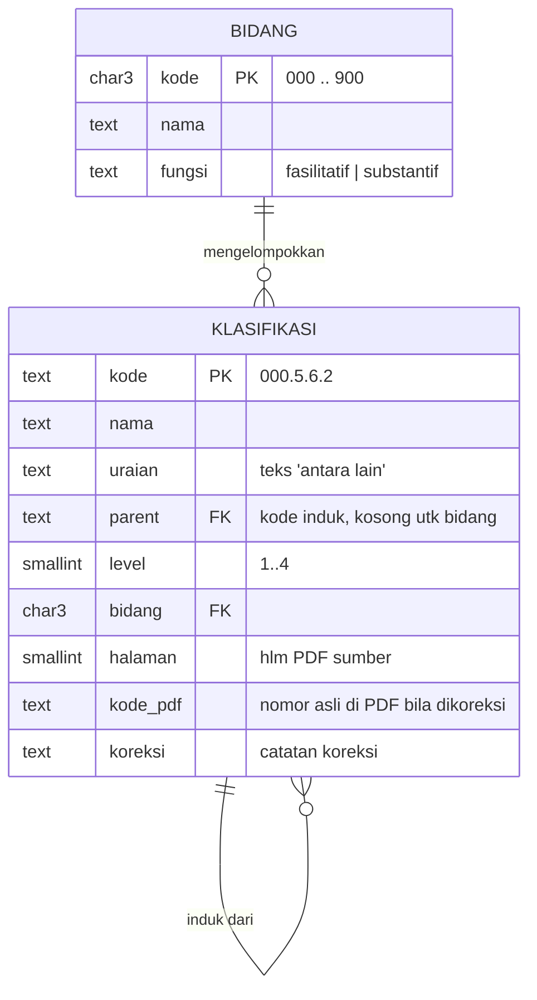
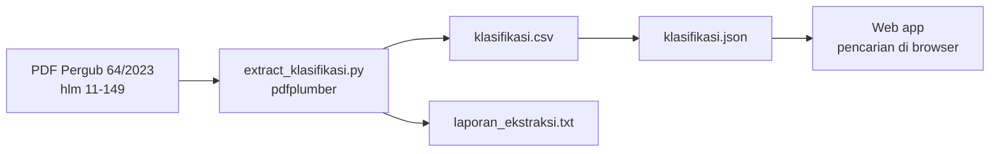

# ERD — Buku Saku Digital Pemprov Bali

Model data untuk versi sederhana: **satu entitas utama** (klasifikasi) yang berjenjang. Tanpa database; data berupa file statis. Dokumen terkait: [PRD.md](PRD.md) · [DESIGN.md](DESIGN.md)

## 1. Diagram



`BIDANG` tidak perlu tabel sendiri: ia adalah baris `KLASIFIKASI` dengan `level = 1`. Diagram memisahkannya hanya agar hubungan lebih jelas.

## 2. Asal data

| Sumber | Halaman PDF | Hasil |
|---|---|---|
| Pasal 4 ayat (7): 10 bidang | 5 | Nama dan kode bidang |
| Lampiran I: Kode Klasifikasi Arsip | 11–149 | Seluruh kode dan nama |
| Lampiran II (hanya sebagai pembanding) | 150–639 | Pemeriksaan silang, dan 3 baris tambahan |

## 3. Kamus data

File: [`data/klasifikasi.csv`](../data/klasifikasi.csv) (UTF-8 dengan BOM, dibuka langsung di Excel)

| Kolom | Tipe | Keterangan |
|---|---|---|
| `kode` | teks | Kode berjenjang dipisah titik, mis. `000.1.10.1`. Kunci utama, unik |
| `nama` | teks | Nama klasifikasi. Nama bidang dan sub-bidang diubah dari huruf kapital menjadi huruf judul |
| `uraian` | teks | Bagian "antara lain: …" dipisahkan dari nama. Kosong bila tidak ada (terisi di 100 baris) |
| `parent` | teks | Kode induk (`kode` tanpa segmen terakhir). Kosong untuk bidang |
| `level` | angka | 1 = bidang, 2 = sub-bidang, 3, 4 = tingkat berikutnya |
| `bidang` | teks | 3 digit pertama kode |
| `halaman` | angka | Nomor halaman PDF tempat baris itu tercetak |
| `kode_pdf` | teks | Nomor kode **asli di PDF**, terisi hanya bila dikoreksi |
| `koreksi` | teks | Alasan koreksi atau penambahan. Kosong bila tidak ada |

File: [`data/klasifikasi.json`](../data/klasifikasi.json), versi ringkas untuk aplikasi (237 KB)

```json
[ { "k": "000.1.2.3", "n": "Perjalanan Dinas Pegawai", "u": "", "h": 11 }, … ]
```

`k` kode · `n` nama · `u` uraian · `h` halaman. Induk, level, dan bidang **dihitung di aplikasi** dari `k`, jadi tidak disimpan ulang.

Contoh baris dengan uraian:

```json
{ "k": "000.5.6.2", "n": "Pemusnahan Arsip", "h": 17,
  "u": "antara lain: SK Penetapan Panitia Penilai Arsip, Pertimbangan Panitia Penilai, Permintaan Persetujuan Kepala ANRI …" }
```

## 4. Aturan data

1. **Kode unik.** Tidak ada kode ganda dan setiap kode (selain bidang) punya induk.
2. **Urutan.** Diurutkan secara numerik per segmen (`000.1.9` sebelum `000.1.10`), bukan menurut abjad.
3. **Induk dan level** diturunkan dari kode: `000.5.6.2` → induk `000.5.6`, level 4.
4. **Judul kelompok** adalah kode yang menjadi induk bagi kode lain (548 kode). **Jenis arsip** adalah kode tanpa turunan (2.441 kode).
5. **Tidak ada data yang dibuang.** Bila kode di PDF salah, nomor aslinya disimpan di `kode_pdf`.

## 5. Ringkasan jumlah

| Level | Jumlah |
|---|---|
| 1 Bidang | 10 |
| 2 Sub-bidang | 56 |
| 3 | 672 |
| 4 | 2.251 |
| **Total** | **2.989** |

(Level 4 termasuk 3 baris tambahan dari Lampiran II.)

## 6. Koreksi data

PDF sumber memiliki salah ketik pada nomor kode. Berikut 10 baris yang dikoreksi atau ditambahkan. Dasar koreksi adalah urutan saudara (nomor loncat atau ganda), letak baris di halaman, dan pembandingan dengan Lampiran II.

| # | Di PDF | Menjadi | Nama | Dasar |
|---|---|---|---|---|
| 1 | 400.4.3.4 | **400.2.3.4** | Monitoring, evaluasi dan analisa kebijakan perlindungan perempuan | Berada di antara 400.2.3.3 dan 400.2.3.5 |
| 2 | 400.5.6.1 (kedua) | **400.5.6.2** | Kepeloporan Pemuda: Kesukarelawanan… | Kode ganda; melanjutkan 400.5.6.1 Kepemimpinan |
| 3 | 400.6.2.1 (kedua) | **400.6.2.2** | Pelindungan | Kode ganda; urutan kehilangan nomor 2 |
| 4 | 400.14.2 (kedua) | **400.14.4** | Pengumpulan, pengolahan, dan penyajian informasi kelembagaan | Induk dari 400.14.4.1–3; Lampiran II hlm 301 mencatat 400.14.4. Nama juga diperbaiki dari "Penumpulan" |
| 5 | 500.12.6.3 (kedua) | **500.12.6.5** | Aplikasi Layanan Publik | Kode ganda; berada setelah 500.12.6.4 |
| 6 | 600.2.12.2 (kedua) | **600.2.15.2** | Pengembangan Materi | Berada setelah 600.2.15.1 (Penerapan Teknologi Konstruksi) |
| 7 | 600.2.12.3 (kedua) | **600.2.15.3** | Pendayagunaan Material dan Peralatan Konstruksi | Berada setelah 600.2.15.2 |
| 8–10 | (tidak ada di Lampiran I) | **400.14.3.1, .2, .3** | Kliping koran · Brosur/Leaflet/poster/plakat · Pengumuman/pemberitaan | Ditambahkan dari Lampiran II hlm 301. Di Lampiran I, tiga baris ini tampak terlewat |

**Tidak diubah (memang demikian di PDF):** `500.2.2` tidak punya nomor 9, dan `500.5.7` tidak punya nomor 5.

Sebaiknya baris 1–10 ditinjau sekali oleh arsiparis. Daftar lengkapnya juga ada di [`data/laporan_ekstraksi.txt`](../data/laporan_ekstraksi.txt) dan di kolom `koreksi` pada CSV.

## 7. Pipeline



Menjalankan ulang: `python scripts/extract_klasifikasi.py`. Skrip ini juga menjadi tempat daftar koreksi (`KOREKSI`, `KOREKSI_NAMA`, `TAMBAHAN`).

## 8. Bila nanti ditambah Lampiran II dan III

Struktur ini siap diperluas tanpa mengubah `klasifikasi`:

- **Lampiran II (keamanan/akses):** tabel `keamanan_akses` dengan kunci `kode`, 1 baris per kode jenis arsip.
- **Lampiran III (retensi):** tabel `retensi` dengan FK `kode` yang boleh kosong, karena Lampiran III tidak memakai kode klasifikasi (hanya penomoran `I. A. 2. c.`) sehingga perlu dicocokkan ke kode.
